<div align="center">


# Tasjeel · تسجيل

**Offline-first desktop voice transcription, built on Faster-Whisper and PyQt6.**

[](https://www.python.org/)
[](https://www.riverbankcomputing.com/software/pyqt/)
[](https://github.com/SYSTRAN/faster-whisper)
[](LICENSE)

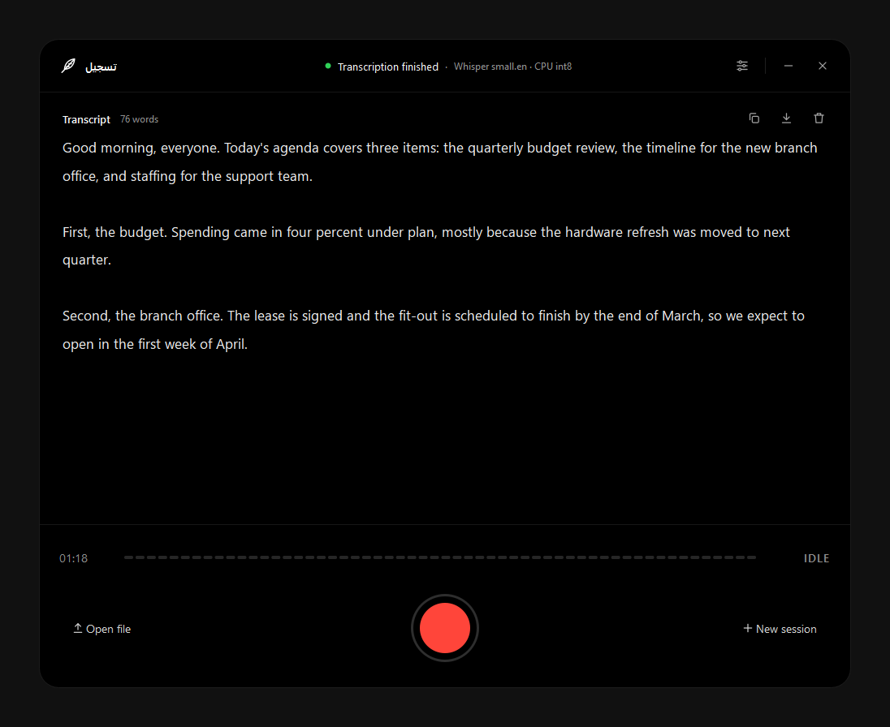

</div>

## Overview

*Tasjeel* (Arabic and Urdu for “recording”) records speech from the microphone and turns it into text on the user’s own machine. By default it runs OpenAI’s Whisper through the CTranslate2-based [Faster-Whisper](https://github.com/SYSTRAN/faster-whisper) runtime, so no audio leaves the device. Google Gemini is available as an optional cloud engine.

The interface is a single 5:4 window with every control inline: one record button, a live input-level meter and a transcript. Settings and context instructions sit in one panel that slides out when it's needed.

## Features

| | |
|---|---|
| **Local transcription** | Faster-Whisper with int8 quantisation. The `small.en` default runs comfortably on a 4-core laptop CPU with 8 GB of RAM. |
| **One-button recording** | The record button turns into a stop button while recording. A pause button appears only while a recording is in progress, and paused time is left out of the clock. |
| **Live input meter** | A 56-bar decibel-scaled level meter shows that the microphone is picking up speech. |
| **Streaming output** | Text appears segment by segment while Whisper is still running. |
| **Context instructions** | Names, terms and spellings are passed to Whisper as an initial prompt, or to Gemini as context. |
| **Export** | Plain text, Word (`.docx`), PDF, HTML and JSON. |
| **Sessions** | Finished transcripts are auto-saved. Undo and redo are available with `Ctrl+Z` and `Ctrl+Y`. |
| **Optional cloud engine** | Google Gemini, with the API key encrypted on disk using PBKDF2 and Fernet. |
| **Hardware-aware** | Falls back to CPU int8 automatically when no NVIDIA GPU is present. |

## Screenshots

| Ready | Recording |
|---|---|
| 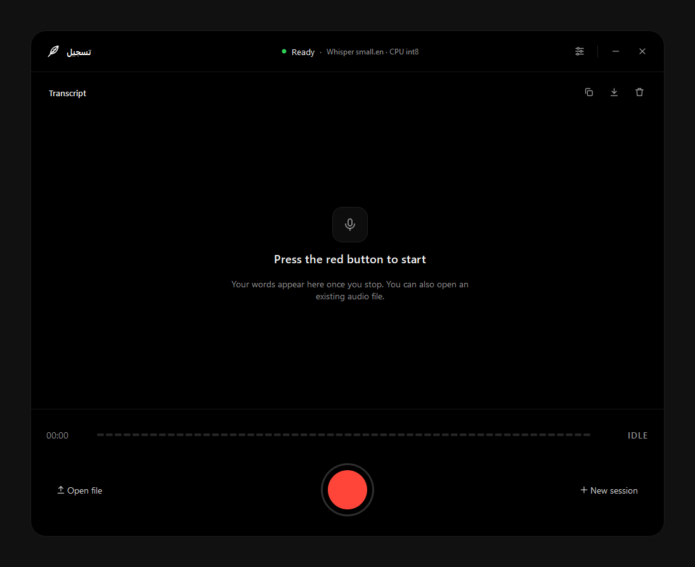 | 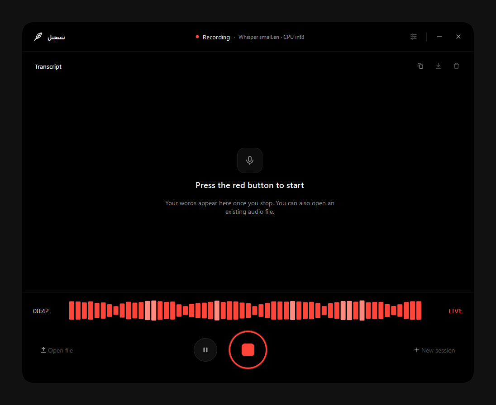 |
| **Paused** | **Transcribing** |
| 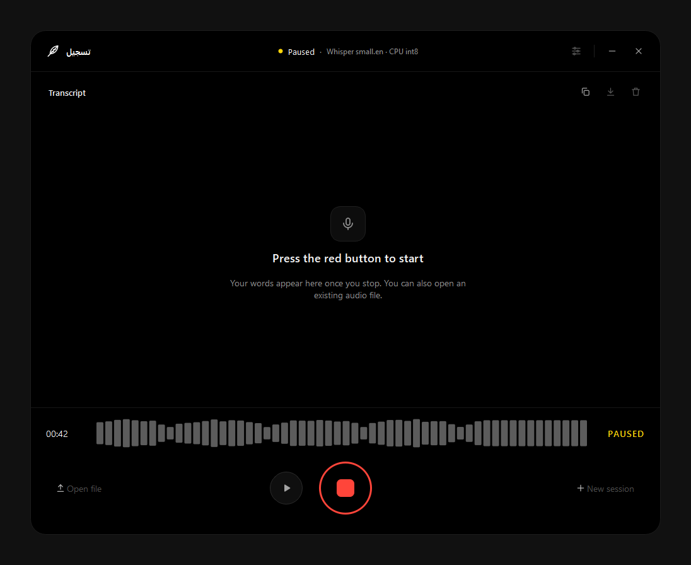 | 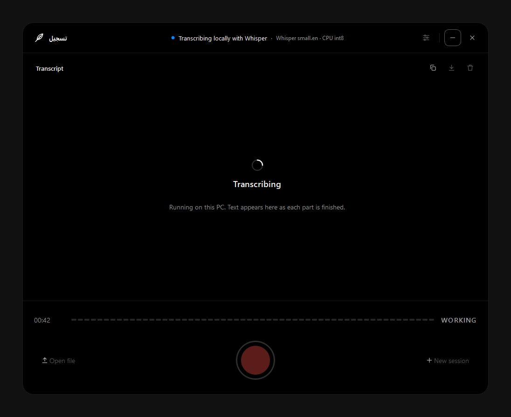 |
| **Settings (Whisper)** | **Settings (Gemini)** |
| 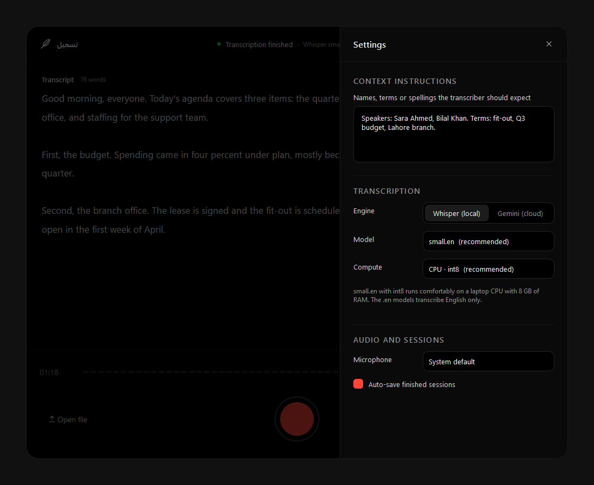 | 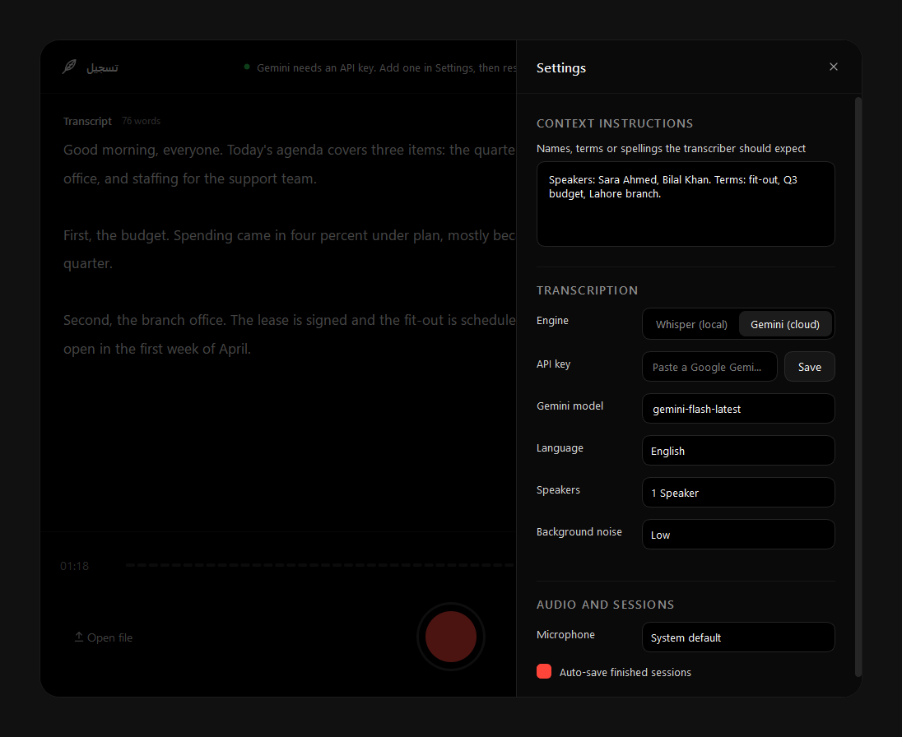 |
| **Export** | **Model download** |
| 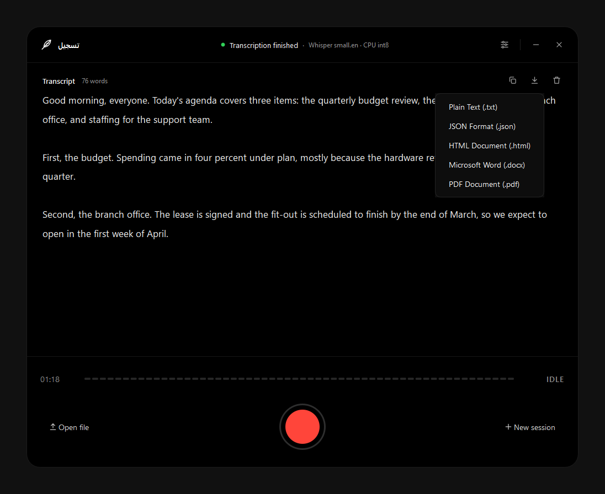 | 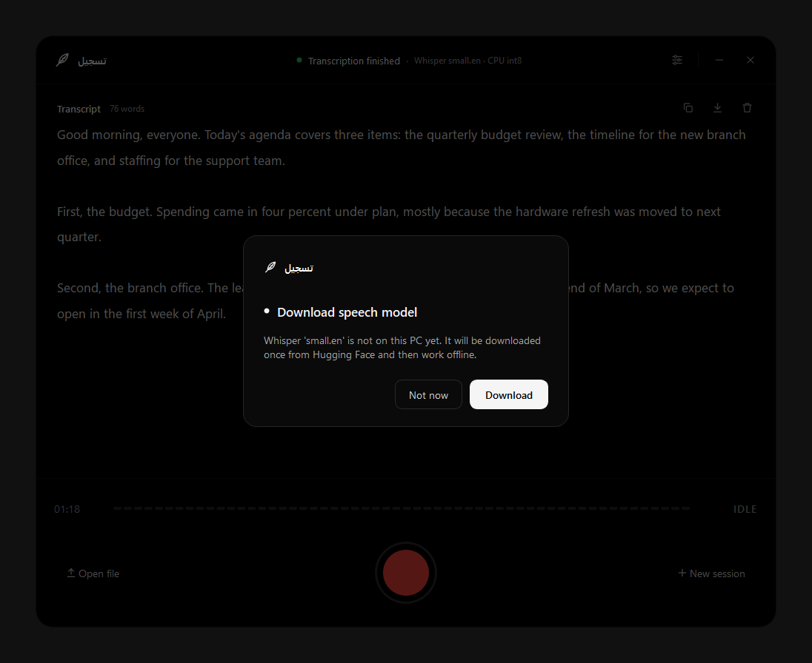 |
| **Download progress** | **Unsaved session prompt** |
| 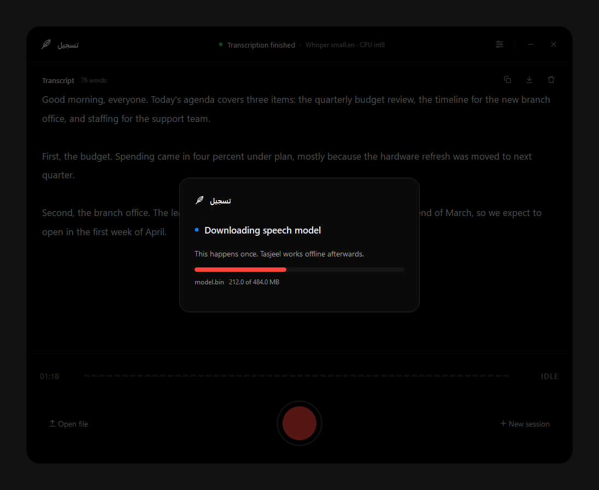 | 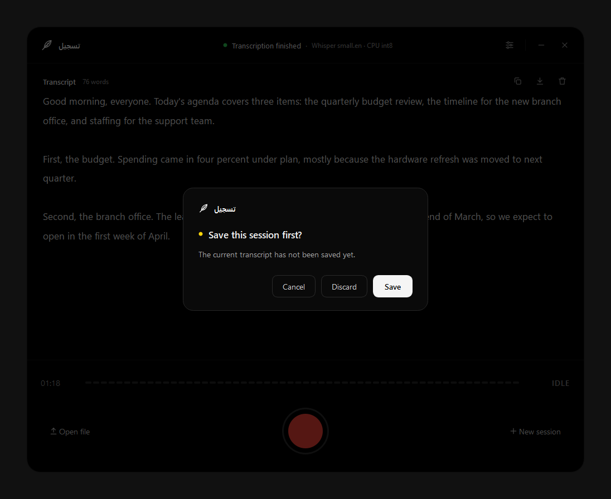 |

## Architecture

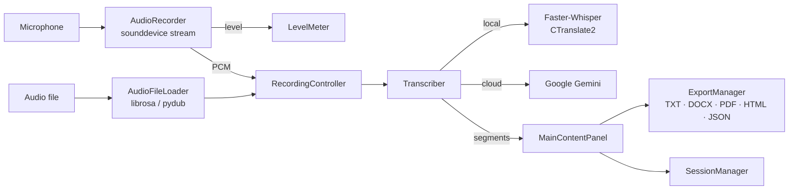

Audio capture, model loading and transcription each run on worker threads and report back to the UI through Qt signals, so the window stays responsive during long transcriptions.

## Project structure

```
Tasjeel/
├── src/tasjeel/
│   ├── __main__.py            Application entry point
│   ├── audio/                 Microphone capture and audio file loading
│   ├── config/                Persistent settings with sensible defaults
│   ├── core/                  Main window and transcription engine
│   ├── exporters/             TXT, DOCX, PDF, HTML and JSON writers
│   ├── managers/              API, export and session management
│   ├── ui/                    Widgets, settings panel, dialogs, icons, theme
│   └── utils/                 Recording controller and key encryption
├── tests/                     Pytest suite
├── docs/                      Screenshots and brand assets
├── pyproject.toml             Package metadata and dependencies
└── requirements.txt
```

## Getting started

### Prerequisites

- Python 3.10 or newer
- Windows 10/11 (also runs on macOS and Linux with PortAudio installed)
- [FFmpeg](https://ffmpeg.org/) on `PATH` for MP3, M4A and AAC files
- Optional: an NVIDIA GPU with CUDA 12 for the large models

### Installation

```bash
git clone https://github.com/DevUAsim/Tasjeel.git
cd Tasjeel
python -m venv .venv
.venv\Scripts\activate
pip install -e .
```

For GPU acceleration, install the CUDA runtime libraries as well:

```bash
pip install -e ".[gpu]"
```

### Running

```bash
tasjeel
```

or, equivalently:

```bash
python -m tasjeel
```

### Desktop shortcut (Windows)

```bash
scripts\install-desktop-shortcut.bat
```

This puts a **Tasjeel** shortcut with the app icon on the current user's desktop. The shortcut runs `scripts\launch-tasjeel.bat`, which creates the virtual environment on first launch and stores downloaded Whisper models in the project's `.models` folder, so the whole installation stays in one place.

On first use, Tasjeel asks before downloading the selected Whisper model from Hugging Face (about 480 MB for `small.en`). After that, it works fully offline.

## Choosing a model

Open the settings panel with the sliders icon or `Ctrl+,`. Every change is saved straight away.

| Model | Download | Best for |
|---|---|---|
| `small.en` **(default)** | ~480 MB | Accurate English on laptop CPUs |
| `distil-small.en` | ~330 MB | Fastest English on CPU |
| `base.en` / `tiny.en` | ~140 / 75 MB | Very low-end hardware |
| `medium.en` | ~1.5 GB | Higher accuracy, slower on CPU |
| `distil-large-v3`, `large-v3-turbo`, `large-v3` | 1.5–3 GB | NVIDIA GPU |

The `.en` models transcribe English only. For Urdu, Arabic or Persian, use the Gemini engine.

## Keyboard shortcuts

| Shortcut | Action |
|---|---|
| `Ctrl+,` | Open or close settings |
| `Ctrl+Z` / `Ctrl+Y` | Undo or redo transcript changes |
| `Esc` | Close the settings panel |
| `Space` / `Enter` | Activate the focused button |

## Testing

```bash
pip install -e ".[dev]"
pytest
```

## Privacy and accuracy

When Whisper is the selected engine, audio and transcripts stay on the local machine. The Gemini engine sends audio to Google, and only when it is selected.

Speech recognition models can mishear words or produce text that was never said. Review transcripts before relying on them.

## License

Released under the [MIT License](LICENSE). Third-party components and their licences are listed in [ACKNOWLEDGEMENTS.md](ACKNOWLEDGEMENTS.md).
